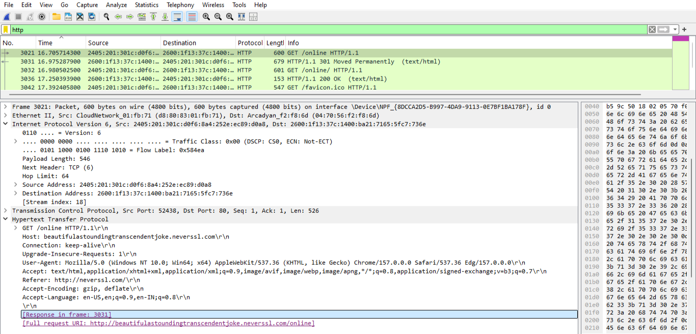
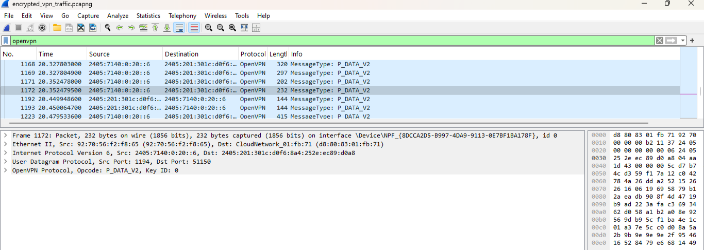
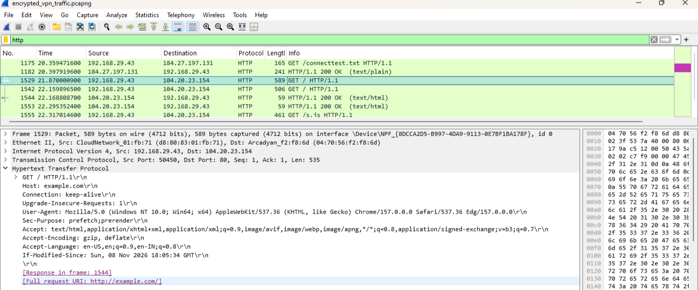

# LAB MANUAL 11: VPN Traffic vs. Unencrypted Communication

## Aim
To capture and analyze unencrypted HTTP traffic and compare it with network traffic captured while connected to a VPN using Wireshark.

## Software / Tools Required
- Wireshark
- OpenVPN Connect
- OpenVPN CloudConnexa
- Web Browser
- Windows Operating System

## Working Procedure

### Step 1: Capture and Analyze Unencrypted Baseline Traffic

1. Open Wireshark and select the active physical network interface (Wi-Fi or Ethernet).
2. Start the packet capture.
3. Open a web browser and visit `http://neverssl.com`.
4. Allow the webpage to load completely.
5. Stop the capture and save it as `unencrypted_baseline.pcapng`.
6. Apply the display filter `http` in Wireshark.
7. Locate an HTTP GET request in the packet list.
8. Expand the Internet Protocol section to observe the source and destination IP addresses.
9. Expand the Hypertext Transfer Protocol section to inspect the Host, User-Agent, and other HTTP headers.

### Step 2: Provision CloudConnexa and Test VPN Connection

1. Create an account on the OpenVPN CloudConnexa portal.
2. Download and install OpenVPN Connect for Windows.
3. Configure the VPN connection profile in CloudConnexa.
4. Download the `.ovpn` configuration file.
5. Open OpenVPN Connect and import the downloaded profile.
6. Connect to the VPN.
7. Open Wireshark and start a fresh packet capture.
8. Visit `http://example.com` in the web browser.
9. Allow the webpage to load and stop the capture.
10. Save the capture as `encrypted_vpn_traffic.pcapng`.

### Step 3: Analyze VPN Traffic

Apply the following display filters in Wireshark:

**1. HTTP Filter**
```text
http
```
- Used to identify HTTP packets.
- HTTP packets were still visible in the second capture.

**2. OpenVPN Filter**
```text
openvpn
```
- Used to identify OpenVPN tunnel packets.
- OpenVPN packets were successfully detected.

**3. UDP Port Filter**
```text
udp.port == 1194
```
- Used to filter UDP traffic on port 1194, if configured for the VPN connection.

## Observations

**Unencrypted Communication:**
- HTTP GET requests and responses were captured successfully.
- Host and User-Agent information were visible in readable form.
- Source and destination IP addresses could be inspected.

**VPN Communication:**
- OpenVPN packets were detected in Wireshark.
- HTTP packets were also visible during the VPN-connected capture.
- The CloudConnexa network and connector remained offline, so successful VPN traffic routing could not be verified.

## Comparison: Unencrypted vs. VPN Communication

| Parameter | Unencrypted HTTP | VPN-Connected Capture |
|---|---|---|
| HTTP packets | Visible | Visible |
| HTTP headers | Readable | Readable in captured HTTP packets |
| OpenVPN packets | Not detected | Detected |
| Encryption verification | Not encrypted | Could not be verified |

**Comparison Summary:** Unencrypted HTTP traffic was directly readable in Wireshark. OpenVPN packets were detected in the second capture, but HTTP packets remained visible because the CloudConnexa connector was offline.

## Screenshots

### 1. Unencrypted HTTP Request



### 2. OpenVPN Tunnel Traffic



### 3. HTTP Traffic During VPN Connection



## Result

Unencrypted HTTP traffic was successfully captured and analyzed using Wireshark. OpenVPN packets were also detected during the second capture. However, due to the offline CloudConnexa network connector, successful routing of HTTP traffic through the VPN tunnel could not be verified.