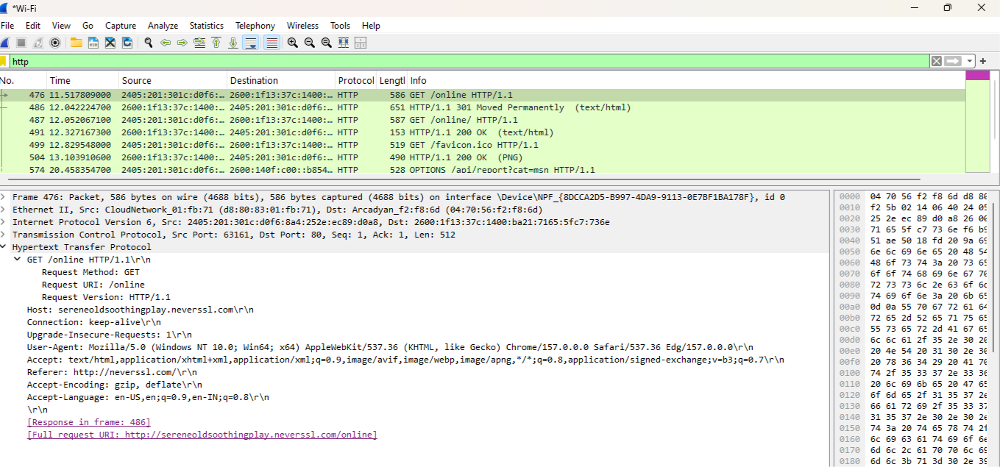
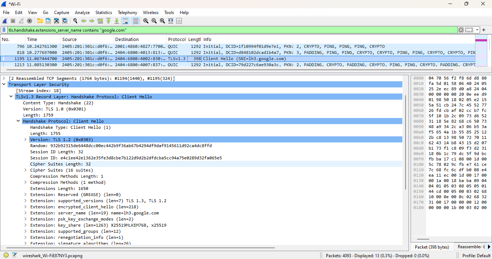
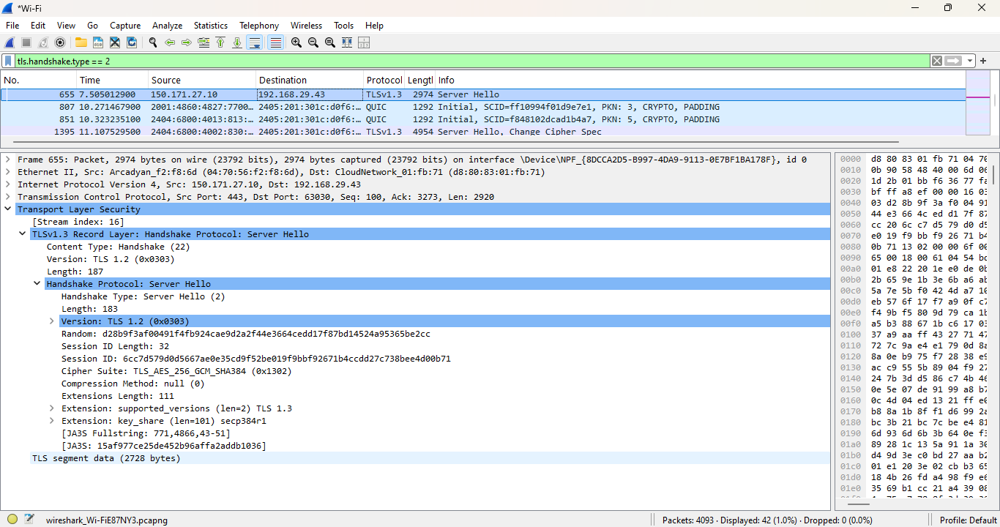
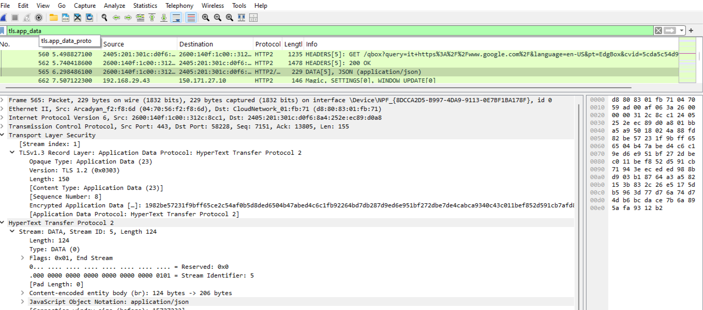

# LAB MANUAL 12: Analysis of Secure and Insecure Communication Protocols Using Wireshark

## Aim
To capture and analyze HTTP and HTTPS network packets using Wireshark and compare insecure and secure communication.

## Software / Tools Required
- Wireshark
- Web Browser
- Internet Connection
- Windows Operating System

## Theory
HTTP (Hypertext Transfer Protocol) transfers data without encryption, making transmitted application data potentially readable during network analysis.

HTTPS (Hypertext Transfer Protocol Secure) uses TLS (Transport Layer Security) to encrypt application data and protect its confidentiality and integrity during transmission.

## Working Procedure

### Step 1: Analyze Insecure HTTP Communication

1. Open Wireshark and select the active network interface.
2. Start capturing packets.
3. Open a web browser and visit `http://neverssl.com/`.
4. Apply the display filter `http` in Wireshark.
5. Select an HTTP request packet.
6. Expand **Hypertext Transfer Protocol** in the Packet Details pane.
7. Observe the request method, Host, URI, and other visible headers.

**Observations:**
- HTTP GET requests and responses were captured.
- Request method was GET.
- Host and Request URI were visible.
- User-Agent and other HTTP headers were readable in plaintext.
- HTTP communication used destination port 80.

### Step 2: Analyze Secure HTTPS Communication

1. Continue capturing packets or start a new capture.
2. Open a web browser and visit `https://www.google.com/`.
3. Apply the display filter `tls` in Wireshark.
4. Select a Client Hello packet and expand Transport Layer Security.
5. Observe the supported TLS versions and Server Name Indication (SNI).
6. Apply the filter `tls.handshake.type == 2` to identify Server Hello packets.
7. Inspect the negotiated TLS version and cipher suite.
8. Apply the filter `tls.app_data` to identify TLS Application Data packets.
9. Inspect the encrypted application data in the Packet Details pane.

**Observations:**
- TLS Client Hello and Server Hello packets were captured.
- TLS 1.3 was observed in the handshake.
- The Client Hello contained a Google-related server name.
- The Server Hello showed the cipher suite `TLS_AES_256_GCM_SHA384`.
- TLS Application Data packets were visible, but their protected application content was not directly readable as plaintext.
- HTTPS communication used destination port 443.

## Wireshark Display Filters

| Display Filter | Purpose |
|---|---|
| `http` | Displays HTTP packets. |
| `tls` | Displays TLS packets. |
| `tls.handshake.type == 2` | Displays Server Hello packets. |
| `tls.app_data` | Displays TLS Application Data packets. |

## Comparison of HTTP and HTTPS

| Feature | HTTP | HTTPS |
|---|---|---|
| Default Port | 80 | 443 |
| Encryption | No built-in encryption | TLS encryption |
| Application Data | Readable in plaintext | Encrypted |
| Security | Vulnerable to eavesdropping | Protects data in transit |

**Comparison Summary:** HTTP request headers and application data may be directly readable in Wireshark, whereas HTTPS uses TLS to encrypt application data. TLS handshake information and connection metadata may still be visible.

## Screenshots

### 1. HTTP Request Analysis

### 2. HTTPS Client Hello

### 3. HTTPS Server Hello

### 4. HTTPS Application Data

## Result

HTTP and HTTPS traffic were successfully captured and analyzed using Wireshark. HTTP request headers were visible in plaintext, whereas HTTPS used TLS 1.3 to protect application data during transmission. The experiment demonstrated the security difference between unencrypted HTTP and encrypted HTTPS communication.

## Precautions

1. Capture only authorized network traffic.
2. Select the correct active network interface before starting packet capture.
3. Generate website traffic while Wireshark is capturing packets.
4. Use the appropriate display filters to identify HTTP and TLS packets.