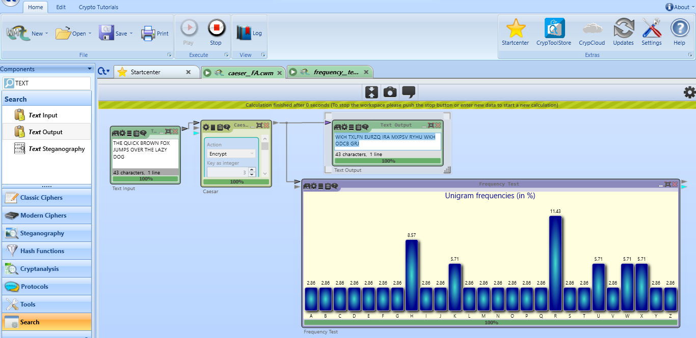
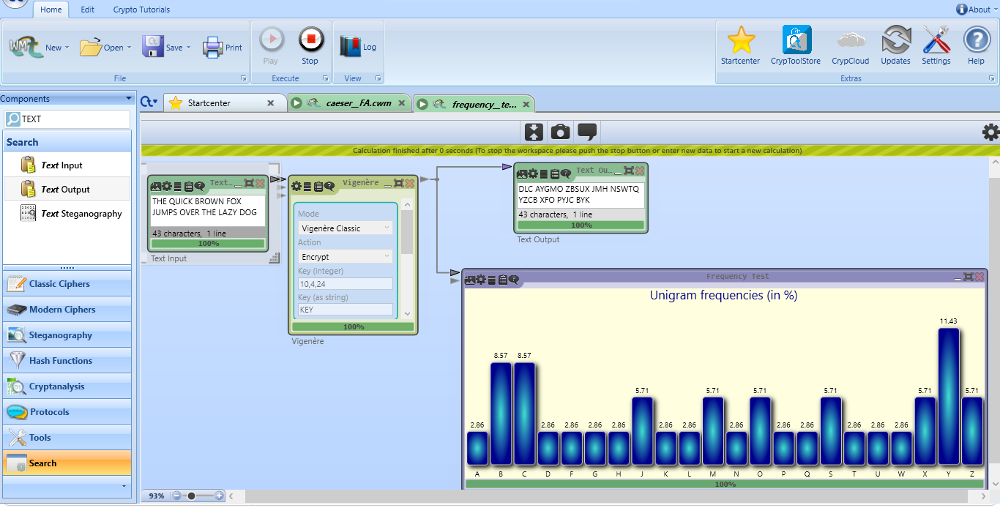

# Experiment 2: Frequency Analysis of Classical Ciphers

## 1. Aim

To perform frequency analysis on classical cipher texts and analyze their vulnerability to cryptanalysis attacks using CrypTool 2.

## 2. Software/Tool Required

- CrypTool 2

## 3. Theory

Frequency analysis is a technique used to study how often letters appear in an encrypted message. In English, letters such as E, T, A, O, and I occur frequently.

An attacker can compare the frequency of letters in ciphertext with the usual frequency of English letters to make guesses about the original message.

Frequency analysis is especially useful against substitution ciphers such as the Caesar Cipher. The Vigenère Cipher is generally more resistant to simple frequency analysis because it uses a keyword to apply different shifts.

## 4. Working Procedure

### A. Caesar Cipher

1. Open CrypTool 2.
2. Enter the plaintext: `THE QUICK BROWN FOX JUMPS OVER THE LAZY DOG`.
3. Select the Caesar Cipher component.
4. Set the shift value to 3.
5. Encrypt the plaintext to obtain the ciphertext.
6. Apply the Frequency Test to the ciphertext.
7. Observe the histogram and record the letter frequencies.

**Plaintext:**

`THE QUICK BROWN FOX JUMPS OVER THE LAZY DOG`

**Key:** `3`

**Ciphertext:**

`WKH TXLFN EURZQ IRA MXPSV RYHU WKH ODCB GRJ`

### B. Vigenère Cipher

1. Open CrypTool 2.
2. Enter the same plaintext used for the Caesar Cipher.
3. Select the Vigenère Cipher component.
4. Enter the keyword `KEY`.
5. Encrypt the plaintext to obtain the ciphertext.
6. Apply the Frequency Test to the ciphertext.
7. Observe the histogram and record the letter frequencies.

**Plaintext:**

`THE QUICK BROWN FOX JUMPS OVER THE LAZY DOG`

**Key:** `KEY`

**Ciphertext:**

`DLC AYGMO ZBSUX JMH NSWTQ YZCB XFO PYJC BYK`

## 5. Screenshots of Tool Setup and Output

### A. Caesar Cipher Frequency Analysis

The screenshot shows the Caesar Cipher output and its frequency histogram.

### B. Vigenère Cipher Frequency Analysis

The screenshot shows the Vigenère Cipher output and its frequency histogram.

## 6. Comparison and Vulnerability Analysis

### A. Caesar Cipher

The ciphertext contains 35 letters, ignoring spaces.

| Letter | Frequency | Percentage |
|---|---:|---:|
| R | 4 | 11.43% |
| H | 3 | 8.57% |
| K, U, W, X | 2 each | 5.71% each |
| Other letters appearing once | 1 each | 2.86% each |

The histogram shows how frequently each letter appears in the encrypted message. The Caesar Cipher uses a fixed shift for every letter, so the original frequency pattern is preserved with the letters changed. This makes it more vulnerable to frequency analysis.

### B. Vigenère Cipher

The ciphertext contains 35 letters, ignoring spaces.

| Letter | Frequency | Percentage |
|---|---:|---:|
| Y | 4 | 11.43% |
| B, C | 3 each | 8.57% each |
| J, M, O, S, X, Z | 2 each | 5.71% each |
| Other letters appearing once | 1 each | 2.86% each |

The Vigenère Cipher uses a repeating keyword to apply different shifts to the plaintext letters. This makes the frequency pattern less obvious and simple frequency analysis more difficult than with the Caesar Cipher.

### C. Comparison

| Feature | Caesar Cipher | Vigenère Cipher |
|---|---|---|
| Key | Shift 3 | KEY |
| Encryption method | Fixed shift | Repeating keyword |
| Frequency pattern | Easier to analyze | More distributed |
| Vulnerability | More vulnerable to simple frequency analysis | More resistant to simple frequency analysis |

**Analysis:** The Caesar Cipher is easier to attack because it shifts every letter by the same amount. The Vigenère Cipher makes letter patterns less obvious by using a repeating keyword. However, it is not completely secure and can still be attacked using suitable cryptanalysis techniques.

## 7. Result

Frequency analysis was performed on Caesar and Vigenère ciphertexts using CrypTool 2. The experiment showed that the Caesar Cipher is more vulnerable to simple frequency analysis, while the Vigenère Cipher makes this type of attack more difficult by using a repeating keyword.