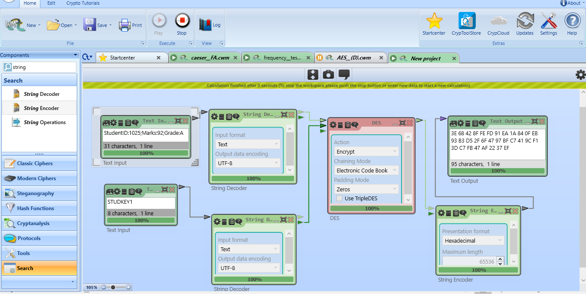
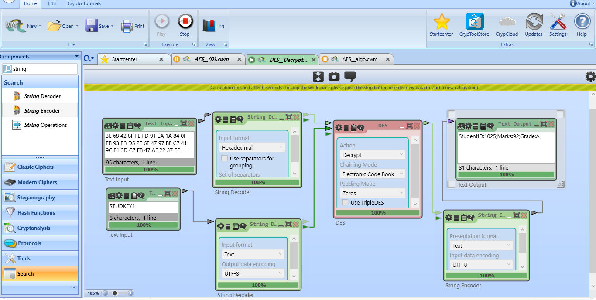
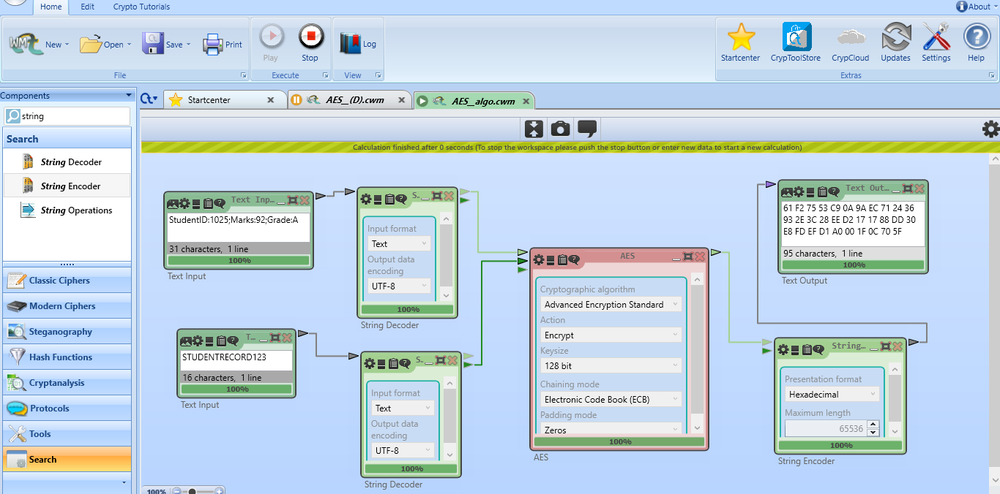
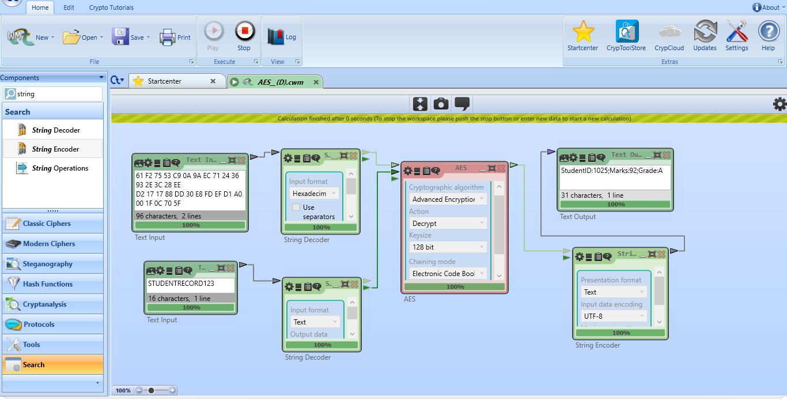

# Experiment 3: DES and AES Encryption

## 1. Aim

To encrypt sample data using DES and AES algorithms and compare their security features and performance using CrypTool 2.

## 2. Software/Tool Required

- CrypTool 2

## 3. Theory

**DES (Data Encryption Standard)** is a symmetric encryption algorithm that uses the same key for encryption and decryption. It uses a 56-bit effective key and processes data in 64-bit blocks. DES is no longer considered secure because its key is too short and can be cracked using brute-force attacks.

**AES (Advanced Encryption Standard)** is also a symmetric encryption algorithm that uses the same key for encryption and decryption. It supports key sizes of 128, 192, and 256 bits and processes data in 128-bit blocks. AES is more secure than DES and is widely used to protect digital information.

Both algorithms convert readable plaintext into ciphertext. Decryption converts the ciphertext back into the original plaintext when the correct key and settings are used.

## 4. Working Procedure

### A. DES Encryption

1. Open CrypTool 2 and create a new workspace.
2. Add two String Decoder components, one DES Encryption component, and one String Encoder component.
3. Set the first String Decoder to Text and enter the sample plaintext.
4. Set the second String Decoder to Text and enter the DES key.
5. Connect the decoded plaintext and key to the DES Encryption component.
6. Connect the encrypted output to the String Encoder and select Hexadecimal format.
7. Run the workspace and observe the encrypted output.

**Plaintext:**

`StudentID:1025;Marks:92;Grade:A`

**DES Key:**

`STUDKEY1`

**Ciphertext (Hexadecimal):**

`3E 68 42 8F FE FD 91 EA 1A 84 0F EB 93 B3 D5 2F 6F 47 97 BF C7 41 9C F1 3D C7 FB 47 AF 22 37 EF`

### B. DES Decryption

1. Add a String Decoder and set its format to Hexadecimal.
2. Enter the DES ciphertext.
3. Connect the decoded ciphertext to the DES Decryption component.
4. Use the same DES key, `STUDKEY1`, and the same mode and padding settings used during encryption.
5. Connect the decrypted output to a String Encoder set to Text.
6. Run the workspace and verify that the original plaintext is recovered.

### C. AES Encryption

1. Open a new workspace in CrypTool 2.
2. Add two String Decoder components, one AES Encryption component, and one String Encoder component.
3. Set the plaintext decoder to Text and enter the same sample plaintext.
4. Set the key decoder to Text and enter the AES key.
5. Select the AES key size as 128 bits.
6. Connect the plaintext and key to the AES Encryption component.
7. Connect the encrypted output to the String Encoder and select Hexadecimal format.
8. Run the workspace and observe the ciphertext.

**Plaintext:**

`StudentID:1025;Marks:92;Grade:A`

**AES Key:**

`STUDENTRECORD123`

**Key Size:** 128 bits

**Ciphertext (Hexadecimal):**

`61 F2 75 53 C9 0A 9A EC 71 24 36 93 2E 3C 28 EE D2 17 17 88 DD 30 E8 FD EF D1 A0 00 1F 0C 70 5F`

### D. AES Decryption

1. Add a String Decoder and set its format to Hexadecimal.
2. Enter the AES ciphertext.
3. Connect the decoded ciphertext to the AES Decryption component.
4. Use the same AES key, `STUDENTRECORD123`, with a key size of 128 bits.
5. Use the same encryption mode and padding settings as in encryption.
6. Connect the decrypted output to a String Encoder set to Text.
7. Run the workspace and verify that the original plaintext is recovered.

## 5. Screenshots of Tool Setup and Output

### A. DES Encryption

### B. DES Decryption

### C. AES Encryption

### D. AES Decryption

## 6. Comparison of DES and AES

| Feature | DES | AES |
|---|---|---|
| Full form | Data Encryption Standard | Advanced Encryption Standard |
| Effective key size | 56 bits | 128, 192, or 256 bits |
| Block size | 64 bits | 128 bits |
| Security | Considered insecure today | Considered secure when properly implemented |
| Resistance to brute-force attacks | Weak because of its short key | Stronger because of its longer keys |
| Performance | Can be efficient in some older or specialized systems | Generally efficient on modern systems, especially with hardware support |
| Current use | Mainly educational or legacy systems | Widely used in modern security systems |

### Security Analysis

DES has a short effective key of 56 bits, making it vulnerable to brute-force attacks. AES supports longer keys, making it much more secure against such attacks. Therefore, AES is preferred for modern applications.

### Performance Analysis

Both algorithms can encrypt and decrypt data efficiently. However, actual performance depends on the computer, software implementation, encryption mode, and available hardware support. AES is often highly efficient on modern processors, especially those with AES hardware acceleration. The screenshots demonstrate the encryption outputs but do not independently measure execution speed.

## 7. Result

The sample student record was encrypted and decrypted using DES and AES in CrypTool 2. The experiment demonstrated that both algorithms can recover the original data when the correct key and settings are used. AES provides stronger security than DES and is the preferred algorithm for modern data protection.