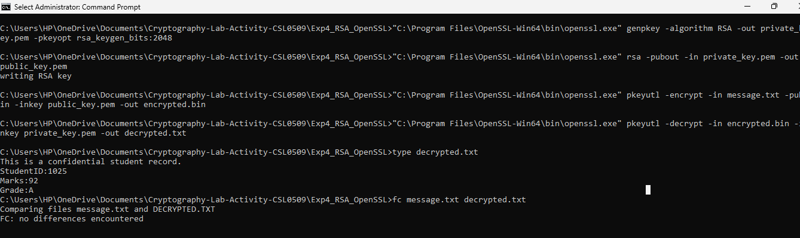

# Experiment 4: RSA Key Generation and File Encryption/Decryption Using OpenSSL

## 1. Aim

To generate RSA public and private key pairs and perform file encryption and decryption using OpenSSL.

## 2. Software/Tool Required

- OpenSSL 4.0.1
- Windows Command Prompt (CMD)
- Notepad

## 3. Theory

RSA is an asymmetric cryptographic algorithm that uses two different keys: a public key and a private key.

- **Public Key:** Used to encrypt the message.
- **Private Key:** Used to decrypt the encrypted message.

RSA provides confidentiality by allowing a message encrypted with the public key to be decrypted using the corresponding private key.

OpenSSL is a software tool used to perform cryptographic operations such as key generation, encryption, and decryption.

## 4. Working Procedure

### Step 1: Generate the RSA Private Key

The following command generates a 2048-bit RSA private key.

```cmd
openssl genpkey -algorithm RSA -out private_key.pem -pkeyopt rsa_keygen_bits:2048
```

Output file: `private_key.pem`

### Step 2: Generate the RSA Public Key

The following command generates the public key from the private key.

```cmd
openssl rsa -pubout -in private_key.pem -out public_key.pem
```

Output file: `public_key.pem`

### Step 3: Create the Sample Message

A text file named `message.txt` was created with the following content:

```text
This is a confidential student record.
StudentID:1025
Marks:92
Grade:A
```

### Step 4: Encrypt the Message

The following command encrypts the original message using the RSA public key.

```cmd
openssl pkeyutl -encrypt -in message.txt -pubin -inkey public_key.pem -out encrypted.bin
```

Output file: `encrypted.bin`

### Step 5: Decrypt the Message

The following command decrypts the encrypted file using the RSA private key.

```cmd
openssl pkeyutl -decrypt -in encrypted.bin -inkey private_key.pem -out decrypted.txt
```

Output file: `decrypted.txt`

### Step 6: Verify the Result

The following command compares the original and decrypted files.
VVVVVVVVV
```cmd
fc message.txt decrypted.txt
```

The output `FC: no differences encountered` confirms that both files contain the same content.

## 5. Screenshot of the Output

The screenshot below shows RSA key generation, file encryption, decryption, and verification.



## 6. Result

RSA public and private keys were generated successfully using OpenSSL. The sample message was encrypted using the public key and decrypted using the private key. The original and decrypted files were compared and found to be identical.

Thus, the experiment was completed successfully.