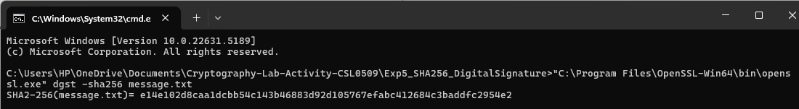
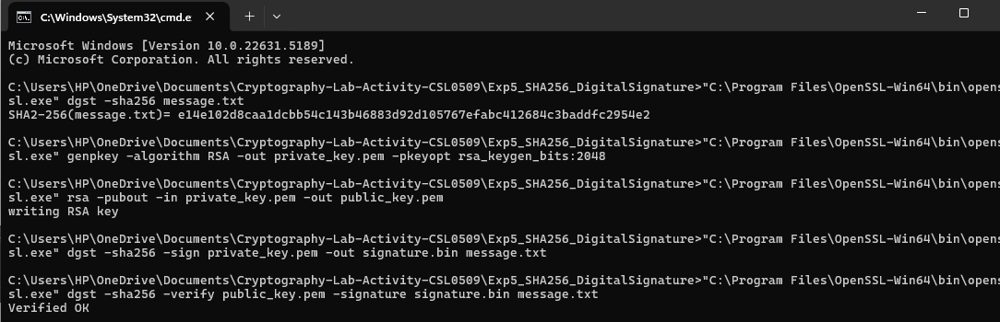
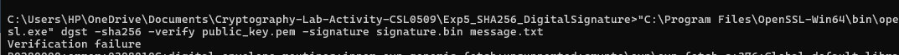

# Experiment 5: SHA-256 Hashing and Digital Signature Verification Using OpenSSL

## 1. Aim
To generate SHA-256 hash values, create digital signatures, and verify their authenticity using OpenSSL.

## 2. Software/Tool Required
- OpenSSL 4.0.1
- Windows Command Prompt (CMD)

## 3. Theory

**SHA-256 Hashing:**

SHA-256 is a cryptographic hash function that converts data into a fixed-length hash of 256 bits. The hash is generally displayed as 64 hexadecimal characters. Even a small change in the original message produces a different hash with very high probability.

**Digital Signature:**

A digital signature is used to check the authenticity and integrity of a message. The sender creates the signature using a private key, and the receiver verifies it using the corresponding public key.

**Signature Verification:**

If the message has not changed and the signature is valid, OpenSSL displays `Verified OK`. If the message is modified after signing, verification fails.

## 4. Working Procedure

### Step 1: Create the Message File

A text file named `message.txt` was created with the following content:

```text
This is a digital signature experiment.
StudentID:1025
Message:Verify authenticity using SHA-256.
```

### Step 2: Generate the SHA-256 Hash

The following command was used to generate the hash:

```cmd
openssl dgst -sha256 message.txt
```

The generated hash was:

```text
e14e102d8caa1dcbb54c143b46883d92d105767efabc412684c3baddfc2954e2
```

### Step 3: Generate RSA Keys

The following command generated a 2048-bit RSA private key:

```cmd
openssl genpkey -algorithm RSA -out private_key.pem -pkeyopt rsa_keygen_bits:2048
```

The public key was generated using:

```cmd
openssl rsa -pubout -in private_key.pem -out public_key.pem
```

### Step 4: Create the Digital Signature

The message was signed using the private key and SHA-256:

```cmd
openssl dgst -sha256 -sign private_key.pem -out signature.bin message.txt
```

The signature was saved in `signature.bin`.

### Step 5: Verify the Digital Signature

The signature was verified using the public key:

```cmd
openssl dgst -sha256 -verify public_key.pem -signature signature.bin message.txt
```

Output:

```text
Verified OK
```

This confirmed that the signature was valid for the original message.

### Step 6: Test Message Integrity

An extra line was added to `message.txt`, and the verification command was run again. OpenSSL returned `Verification failure`, showing that the modified message did not match the original signature.

After the test, the added line was removed and the original message was restored. Verification again returned `Verified OK`.

## 5. Screenshots

### SHA-256 Hash Generation


### Digital Signature Creation and Verification


### Verification After Message Modification


## 6. Result

The SHA-256 hash of the message was generated successfully using OpenSSL. An RSA digital signature was created using the private key and verified using the corresponding public key. Verification succeeded for the original message and failed when the message was modified.

Thus, the experiment was completed successfully.
