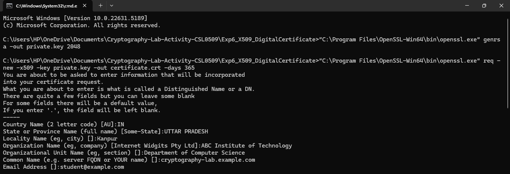
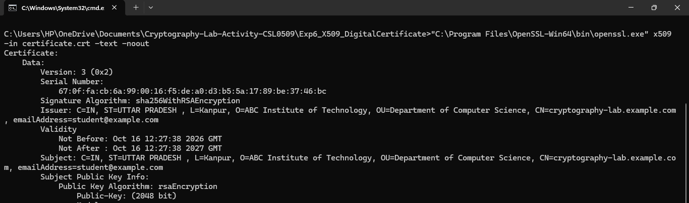
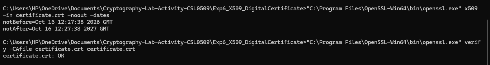

# Experiment 6: Creating and Analyzing a Self-Signed X.509 Digital Certificate Using OpenSSL

## Aim
To create a self-signed X.509 digital certificate using OpenSSL and analyze its attributes, validity period, and security features.

## Software/Tool Required
- OpenSSL
- Windows Command Prompt (CMD)

## Theory
An X.509 digital certificate is an electronic document that connects an identity with a public key. It contains information such as the subject's name, issuer, public key, validity period, and digital signature.

A self-signed certificate is signed using its own corresponding private key instead of being issued by an external Certificate Authority (CA).

OpenSSL is a tool used to generate keys, create certificates, and examine their details.

## Working Procedure

### Step 1: Generate a Private Key
The following command was used to generate a 2048-bit RSA private key:

```cmd
openssl genrsa -out private.key 2048
```

The private key was saved in the file `private.key`.

### Step 2: Create a Self-Signed Certificate
The following command was used to create a self-signed certificate with a validity period of 365 days:

```cmd
openssl req -new -x509 -key private.key -out certificate.crt -days 365
```

Basic certificate details, such as country, state, organization, organizational unit, and Common Name (CN), were entered when prompted.

The generated certificate was saved as `certificate.crt`.

### Step 3: Inspect the Certificate
The following command was used to display the certificate's details:

```cmd
openssl x509 -in certificate.crt -text -noout
```

The output displayed the certificate version, serial number, issuer, subject, validity period, public key information, and signature algorithm.

### Step 4: Check the Validity Period
The following command was used to check the certificate's validity dates:

```cmd
openssl x509 -in certificate.crt -noout -dates
```

The `notBefore` field indicates when the certificate becomes valid, while `notAfter` indicates when it expires.

### Step 5: Verify the Certificate
The following command was used to verify the self-signed certificate:

```cmd
openssl verify -CAfile certificate.crt certificate.crt
```

The output was:

```text
certificate.crt: OK
```

This indicates that the certificate passed the verification check using itself as the trusted certificate.

## Screenshots

### 1. Certificate Generation


### 2. Certificate Attributes


### 3. Certificate Validity and Verification


## Security Analysis

1. **Public Key:** The certificate contains the public key associated with the private key.
2. **Digital Signature:** The signature helps detect changes to the certificate and verify that it was signed by the corresponding key.
3. **Validity Period:** The certificate is valid for the configured period of 365 days.
4. **Self-Signed Certificate:** The issuer and subject are normally the same for a self-signed certificate.
5. **Private Key Security:** The private key must be kept secret and should not be uploaded to GitHub.
6. **Trust Limitation:** A self-signed certificate is not automatically trusted by browsers, websites, or other systems.

## Result
A self-signed X.509 digital certificate was successfully generated using OpenSSL. Its attributes and validity period were examined, and the certificate verification command returned `certificate.crt: OK`.