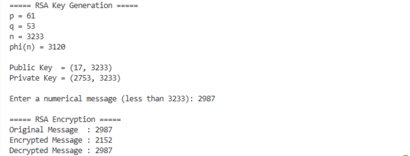
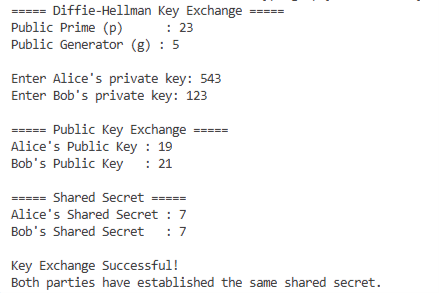

# Experiment 7: RSA and Diffie–Hellman Algorithms

## Aim
To implement RSA and Diffie–Hellman algorithms using Java to demonstrate public-key cryptography and secure key exchange.

## Software/Tool Required
- Java Development Kit (JDK)
- Visual Studio Code (VS Code)

## Theory

**RSA Algorithm:** RSA is an asymmetric cryptographic algorithm that uses a public key and a private key. The public key is used for encryption, while the private key is used for decryption.

**Diffie–Hellman Algorithm:** Diffie–Hellman is a key exchange algorithm that allows two parties to establish the same shared secret over a public channel without directly transmitting the secret.

## Working Procedure

### Part A: RSA Algorithm

1. Open Visual Studio Code and create a file named `RSA.java`.
2. Select two prime numbers, `p = 61` and `q = 53`.
3. Calculate `n = p × q` and Euler's totient function, `phi(n)`.
4. Select the public exponent and calculate the private exponent.
5. Enter a numerical message less than `n`.
6. Encrypt the message using the public key.
7. Decrypt the ciphertext using the private key.
8. Compare the original and decrypted messages.

### Part B: Diffie–Hellman Algorithm

1. Create a file named `DiffieHellman.java`.
2. Set the public prime `p = 23` and generator `g = 5`.
3. Enter Alice's and Bob's private keys.
4. Calculate their public keys using modular exponentiation.
5. Exchange the public keys and calculate the shared secret independently.
6. Compare both shared secrets to verify that the key exchange is successful.

## Screenshots

### 1. RSA Execution Output
Shows RSA key generation, encryption, and decryption of the numerical message.

### 2. Diffie–Hellman Execution Output
Shows public-key exchange and verification that Alice and Bob generate the same shared secret.

## Security Analysis

- RSA demonstrates asymmetric encryption and decryption using public and private keys.
- Diffie–Hellman demonstrates how two parties can derive a common shared secret.
- The small numerical parameters used in these programs are for educational demonstration only and are not secure for real-world cryptographic applications.

## Result

The RSA algorithm successfully encrypted and decrypted the numerical message, recovering the original value. The Diffie–Hellman algorithm successfully established the same shared secret for both parties.
