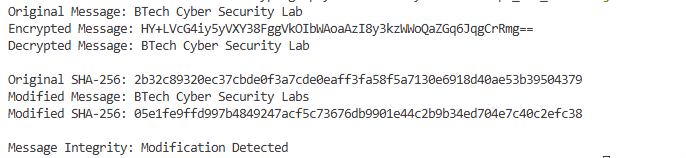

# Experiment 8: AES Encryption and SHA-256 Hashing

## Aim

To implement AES encryption and decryption using Java and demonstrate message integrity verification using the SHA-256 hash function.

## Software/Tool Required

- Java Development Kit (JDK)
- Visual Studio Code (VS Code)

## Theory

**AES (Advanced Encryption Standard)** is a symmetric encryption algorithm that uses the same secret key for encryption and decryption. In this experiment, AES-256 with GCM mode is used to encrypt and decrypt a text message securely. A random initialization vector (IV) is generated to support the encryption process.

**SHA-256** is a cryptographic hash function that generates a fixed-length 256-bit hash value for a message. Even a small change in the message produces a different hash value, making it useful for checking message integrity.

In this experiment, the original and modified messages are hashed and their hash values are compared. Different hash values indicate that the message has been modified.

## Working Procedure

1. Create the Java program `SecureMessageDemo.java` in VS Code.
2. Generate a 256-bit AES secret key and a random initialization vector (IV).
3. Encrypt the original message using AES-GCM.
4. Decrypt the encrypted message using the same key and IV.
5. Calculate the SHA-256 hashes of the original and modified messages.
6. Compare the hash values to detect changes in the message.
7. Display the encrypted message, decrypted message, hash values, and integrity verification result.

## Screenshots

### AES Encryption and SHA-256 Output

## Result

The Java program was successfully executed to demonstrate AES-256 encryption and decryption using AES-GCM. The encrypted message was displayed in Base64 format and decrypted back to its original plaintext.

SHA-256 hash values were calculated for the original and modified messages. Since the two messages produced different hash values, the program displayed "Modification Detected", demonstrating how hashing can be used to identify changes in message content.