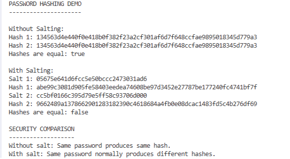

# Experiment 9: Password Hashing With and Without Salting

## 1. Aim

To implement password hashing with and without salting and evaluate resistance against common password attacks using Visual Studio Code.

## 2. Software/Tool Required

- Java Development Kit (JDK)
- Visual Studio Code (VS Code)

## 3. Theory

### 3.1 Password Hashing

Password hashing is a security technique that converts a password into a fixed-length hash value using a cryptographic hash function. Instead of storing passwords in plaintext, systems store password hashes to improve security. This experiment uses SHA-256 to demonstrate password hashing.

### 3.2 Password Hashing Without Salting

In password hashing without salting, the password is directly processed by the hash function. The same password always produces the same hash value. This makes it easier to identify reused passwords and leaves stored hashes more vulnerable to precomputed rainbow-table attacks.

### 3.3 Password Hashing With Salting

Salting involves adding a random value, called a salt, to a password before hashing it. Different salts produce different hash values even when the same password is used. This makes precomputed rainbow-table attacks more difficult. However, salting alone does not prevent brute-force or dictionary attacks against weak passwords.

## 4. Working Procedure

1. Create a Java program named `PasswordHashing.java` in Visual Studio Code.
2. Import the required Java libraries for SHA-256 hashing and random number generation.
3. Define a sample password for testing.
4. Generate the password hash twice without salting and compare the results.
5. Generate two different random salts using `SecureRandom`.
6. Hash the same password using each salt.
7. Compare the salted hash values and observe the difference.
8. Evaluate the benefits and limitations of salting against common password attacks.

## 5. Screenshots

### Password Hashing Execution Output

## 6. Comparison Against Password Attacks

| Security Aspect | Without Salting | With Salting |
|---|---|---|
| Same password, same hash | Yes | Normally no, with different salts |
| Rainbow-table attacks | More vulnerable | Greatly hindered |
| Identification of reused passwords | Easier | More difficult |
| Brute-force guessing | Possible | Still possible |
| Protection against weak passwords | Limited | Limited |
| Production password storage | Not recommended | Use a dedicated password-hashing algorithm |

Salting improves password security, but it does not make weak passwords resistant to guessing attacks. For production password storage, dedicated password-hashing algorithms such as Argon2id, bcrypt, or scrypt are recommended.

## 7. Result

The Java program was successfully executed in Visual Studio Code to demonstrate password hashing with and without salting. Without salting, the same password produced identical hash values. With different random salts, the same password produced different hash values.

The comparison showed that salting makes precomputed rainbow-table attacks more difficult and reduces the ease of identifying reused passwords. However, brute-force and dictionary attacks remain possible, particularly against weak passwords. Dedicated password-hashing algorithms are recommended for secure password storage.
